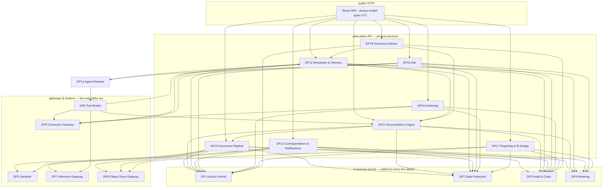

# Green team — the v1 service topology: count, size, and the call graph

> **STATUS:** WORKING MATERIAL
> **V1 AUTHORITY:** NO — a green-team answer to one question; nothing adjudicates it yet, and `docs/build/red-service-topology.md` argues the question cannot be answered with a number at all.
> ⚠️ **Written against a tree that was moving underneath it, and it says so** — see its own §0, which records that G79 and G80 were being applied to four `model/` files concurrently and that three of its derived counts disagree with `docs/HANDOFF.md` §0 by one. **Re-run every command in its §0 before trusting a number here**, and treat its `model/` line numbers as approximate. It builds on `docs/component-architecture.html` and `docs/service-stacks.html`, both of which are banner-marked STALE. ⚠️ **Pass H did not stop where this file stops reading** — G87 and G89 in particular bear on the seam and the streams. Derive pass H's range from `docs/HANDOFF.md` §3 rather than quoting one.
> ✅ **BODY ANNOTATED 8 Aug 2026 — analysis untouched, two blocks added.** §4 gains the four rulings that constrain the deployable count (**G103** no Redis — a load-bearing confirmation of the count of six; **G104** no model id in engine code; **G105** the matching algorithm and its bound; **G107** the whole pipeline is data-plane, ⚠️ which costs per-plane orchestration this table does not carry). §13 records that **none of its ten open items closed**, and that row 1 now has G100/G101/G107 behind it. **Taken is not applied** — no deployable exists and no AWS resource has been created.
> *Banner added 8 Aug 2026; body annotated the same day.*
> 🛑 **SUPERSEDED ON THE DEPLOYABLE COUNT, 18 Sep 2026 — successor
> `docs/tech-stack.md` §7.** This file and its red counterpart argued the count
> from the model and reached different answers. **The successor does not argue
> it: it maps `compose.yaml` one-to-one onto AWS** — six services and two
> networks become two ECS services, two run-tasks, two Aurora clusters and two
> security-group pairs (G253) — so the count is now DERIVED from a file in the
> tree rather than estimated from the model. **The reasoning here is still worth
> reading; the number is not the number.**

> 🟡 **A PROPOSAL. NOTHING HERE IS APPLIED.** No file in `model/`, `docs/contracts/`
> or `Mockups/` is changed by this document. Written 8 August 2026 at
> `0aba16f0`, against **G1–G86** (`docs/HANDOFF.md` §3 and pass H), the four
> OpenAPI documents, the eighteen drawn screens, and the sixteen `model/` modules.
>
> **Answering, verbatim:** *"the count, size and shape of the APIs we will need in
> our build. Basically I want to know how many component services will we have and
> how they talk to each other."*
>
> ⚠️ **THE TREE MOVED WHILE THIS WAS BEING WRITTEN.** Other agents were applying
> G79 and G80 to `model/policy.ts`, `model/governance.ts`, `model/catalog.ts` and
> `model/examples.ts` concurrently. At the moment of derivation `POLICY_KINDS` had
> **eight** members (`CLAUDE.md` and `docs/v1-trim-proposal.md` §4.8 both say
> seven — `managed_service_use` had just landed), exports read **684** (§0 of
> `HANDOFF` says 683) and drop markers **229** (says 228). **Re-run every command
> in §0 before trusting a number here.** Line numbers cited below are approximate
> for those four files.

---

## 0. Reproduce every count on this page

```bash
git rev-parse --short HEAD                                   # 0aba16f0
ls model/*.ts | wc -l                                        # 16 modules
grep -h '^export ' model/*.ts | wc -l                        # 684 exports
grep -rho '@dropped-for-v1' model/*.ts | wc -l               # 229 markers
grep -c 'operationId:' docs/contracts/*.openapi.yaml         # 36 + 12 + 17 = 65
awk '/enum:/{f=1;next} f&&/^ *- /{c++} f&&!/^ *- /{f=0} END{print c}' \
  docs/contracts/errors.yaml                                 # 71 error codes
awk '/^export const CAPABILITIES = \{/,/^\}/' model/access.ts \
  | grep -cE '^  [a-zA-Z]+:'                                 # 36 capabilities
awk '/^export const ACCESS_RESOURCE_CLASSES = \{/,/^\}/' model/governance.ts \
  | grep -cE '^  [a-zA-Z]+:'                                 # 13 resource classes
awk '/^export const TOOL_KEYS = \{/,/^\} as const/' model/domain.ts \
  | grep -cE '^  [a-zA-Z]+:'                                 # 18 tools
ls Mockups/rec/*.dc.html | wc -l                             # 18 screens (12 product, 6 design system)
node tools/planner/extract.mjs                               # 140 nodes · 249 edges · 154 gaps
```

Live-versus-dropped per module — this is the **size input** for every service below:

```bash
for f in model/*.ts; do awk -v F="$(basename $f)" \
  '/@dropped-for-v1/{d=1;next} /^export /{if(d)dr++; else lv++; d=0; next} NF==0{d=0} \
   END{printf "%-18s live=%-4d dropped=%-4d\n", F, lv, dr}' "$f"; done
```

| module | live | dropped | | module | live | dropped |
|---|---:|---:|---|---|---:|---:|
| `domain.ts` | 144 | 17 | | `learning.ts` | 28 | 33 |
| `kernel.ts` | 72 | 0 | | `identity.ts` | 17 | 0 |
| `access.ts` | 49 | 0 | | `billing.ts` | 14 | 32 |
| `governance.ts` | 38 | 4 | | `correspondence.ts` | 12 | 0 |
| `policy.ts` | 32 | 15 | | `examples.ts` | 12 | 0 |
| `agents.ts` | 31 | 8 | | `evaluation.ts` | 11 | 21 |
| `catalog.ts` | 10 | 1 | | `observability.ts` | 6 | 12 |
| | | | | `presentation.ts` | 2 | 51 |
| | | | | `deployment.ts` | 0 | 12 |

**Read that table as the build budget.** `presentation.ts` and `deployment.ts` are
dropped whole (G57/G82 buy the first, G36 defers the second), `billing.ts` is
two-thirds dropped, and `domain.ts` alone carries 144 live exports — which is why
one service below is four times the size of any other.

---

## 1. The answer, on one page

| | Count | |
|---|---:|---|
| **Component services in v1** | **23** | 18 data plane · 5 control plane |
| …plus **bought**, provisioned but not built | **1** | Amazon Quick Suite (G57/G82) |
| **Deployable processes** | **6** | not 23 — see §4 |
| **API operations in v1, total** | **≈ 234** | ±10%; §6 derives it |
| …of which **already written** | **60** | of the 65 that exist; G36 kills 5 |
| …of which **must be written** | **≈ 174** | |
| …**administration alone**, both planes | **≈ 98** | **56% of everything unwritten** |
| `Ask`, a tier with zero operations today | **≈ 17** | G62 |
| **Cross-plane edges in the whole system** | **9** | 4 up (push), 5 down (pull). §5.4 |
| **Upward reads from tenant data into the control plane** | **0** | invariant 3, and §5.4 lists every edge so you can check |

**The one-sentence shape.** A single TypeScript monorepo (G71) compiles into **six
processes**: a data-plane API, a data-plane worker, a control-plane API, and three
processes that exist only because something must not be allowed to police itself —
the **sanitiser**, the **agent runtime**, and the **connector**. Everything else is
a module with a contract inside one of those six.

**The one number that should change a plan.** *Administration is 56% of the
unwritten API surface.* Not the matcher, not the agent, not `Ask`. G58 put finance
in charge of authoring definitions and that decision — not the reconciliation
engine — is what v1 costs.

---

## 2. Method: what counts as a service, and the bar for a separate one

`docs/contracts/README.md:8-30` already settled the principle and this document
keeps it: **transport differs, contract discipline does not.** A service here is a
component with a named owner, a named subject in `model/`, an explicit operation
set, and an explicit error set — whether it is reached over HTTP, over a queue, or
by a function call in the same process.

So there are two counts and they answer different questions:

- **23 services** answers *"how many contracts do we have to write and keep
  honest?"*
- **6 processes** answers *"how many things do we deploy, page on, and pay for?"*

**The bar for a service being its own PROCESS** — and there are only three reasons,
taken from the record rather than invented:

| # | Bar | Instances |
|---|---|---|
| **B1** | **A component must not enforce its own limits.** Pass A's own words for why F13 exists | Tool Broker vs Agent Runtime |
| **B2** | **A credential or an egress boundary is only enforceable across a process boundary.** `docs/contracts/README.md:24` | Sanitiser (no credentials, no egress) · Connector (holds every customer credential) |
| **B3** | **A plane boundary requires it.** Invariant 3 | control-plane API vs data-plane API |

**Everything that clears none of those three bars is a module, not a process.** That
is G55 applied mechanically rather than by taste, and it is what takes the prior
attempt's 35 services down to 23 and its implied process count down to 6.

**The merge rule I applied, stated so you can audit it:** two components merge
unless (a) they own different aggregates, (b) they have different write patterns on
the same aggregate, or (c) separating them is itself the safety property. Every
merge in §8 names which of the three it failed.

---

## 3. The plane partition — and what G36 changed about it

Invariant 3 is *"the control plane publishes downward and never reads tenant
data."* Three decisions reshape how that is enforced in v1, and getting this wrong
is the most expensive mistake available here.

**G36 removes the account boundary.** BYOA slips to v1+1, so both planes run in one
1CloudHub AWS account (000000000000). The prior architecture leaned on the account
boundary — `docs/component-architecture.html` §4: *"A single query downward would
collapse the account boundary that the whole topology is built on."* **That
boundary no longer exists.** What survives is pass F's decision: *"Plane split
enforced by separate schemas and DB roles, one cluster"*
(`docs/data-architecture.md` §4). **In v1 invariant 3 is a database grant, not a
network fact.** If nobody writes that grant, invariant 3 is a comment.

**G50 puts the control plane in v1** and reverses its direction. All 12 existing
control-plane operations are data-plane-**initiated** — fetch, pull, report. G50
adds the acts that *originate* there: create a tenant, publish a pack version,
publish a policy bundle, set a model, issue a `TenantAccessGrant`. None has a
contract, a screen, or in two cases a capability.

**G82 puts the BI layer in another region.** Quick Suite runs in `ap-southeast-2`
and SPICE ingestion moves tenant data across the residency boundary **on every
refresh**. That pipeline originates in the **data plane**, not the control plane —
see §5.5, because getting the direction wrong here would put tenant data on a
control-plane read path.

```
                    ap-southeast-1                        ap-southeast-2
 ┌───────────────────────────────────────────────┐    ┌──────────────────┐
 │  CONTROL PLANE   schema: cp_*   role: cp_rw   │    │  Amazon Quick    │
 │  CP1 Tenancy & Identity   CP2 Staff Access    │    │  Suite (BOUGHT)  │
 │  CP3 Publication          CP4 Tenant Infra    │    │  account-per-    │
 │  CP5 Metering Ingest                          │    │  tenant (G70)    │
 └───────────────────────────────────────────────┘    └──────────────────┘
        ▲ 4 pushes            ▼ 5 pulls (initiated below)      ▲
        │                     │                                │ SPICE refresh
        │  ══════ the only nine edges that cross ══════        │ (data-plane
        │                     │                                │  EGRESS, §5.5)
 ┌──────┴─────────────────────┴────────────────────────────────┴───────────┐
 │  DATA PLANE      schema: dp_*   role: dp_rw   RLS on every tenant table │
 │  DP1..DP18                                                             │
 └────────────────────────────────────────────────────────────────────────┘
```

**The rule in one line, and it is checkable:** the `cp_rw` role holds **no `SELECT`
grant on any `dp_*` relation**. Write that migration first; it is the whole of
invariant 3 in v1.

---

## 4. The six deployables

| # | Process | Hosts | Why it is its own process | Scaling shape |
|---|---|---|---|---|
| **1** | **Data-plane API** | DP1–DP4, DP6, DP8, DP10–DP13, DP15–DP18 | B3 — it is the data plane | request-scaled |
| **2** | **Data-plane worker** | the async halves of DP10 (extraction), DP11 (matching), DP4 (usage ship), DP13 (digests), DP17 (SPICE refresh) | not a bar — a **runtime** split. Extraction and set-reconciliation are minutes-long; putting them in the request process makes one slow docket a p99 incident | queue-scaled |
| **3** | **Sanitiser** | DP5 | **B2** — *"must hold no credentials and no network egress, which is only enforceable across a process boundary"* | burst |
| **4** | **Agent runtime** | DP14 | **B1** — it is the thing the Tool Broker constrains, and the broker cannot live inside it | concurrency-scaled |
| **5** | **Connector** | DP9 | **B2** — it resolves and holds every `credentialRef`. G27 knowingly left one credential serving both read and write-back, so a compromise here reaches the customer's ledger | connection-pooled |
| **6** | **Control-plane API** | CP1–CP5 | **B3** | low volume |

Plus **Amazon Quick Suite**, bought, in `ap-southeast-2`, provisioned by CP4.

> ✅ **FOUR RULINGS ON 8 Aug 2026 CONSTRAIN THIS TABLE. TAKEN, NOT APPLIED — no
> deployable exists and no AWS resource has been created.**
>
> **G107 — the whole reconciliation pipeline is DATA-PLANE.** This confirms rows 1
> and 2 and makes the plane assignment a **grant, not a convention**: the Step
> Function, its Lambdas, the Fargate task, the S3 landing bucket, EventBridge and
> every log they write run under the **data-plane DB role**, because a
> reconciliation batch *is* tenant data and invariant 3 forbids the control plane
> reading it. The control plane's only involvement is publishing the model catalogue
> (G104), the pack and the policy bundle downward, and receiving the metering
> attestation back — which is exactly §6.3's nine downward edges. ⚠️ **The cost is
> per-plane orchestration infrastructure to provision and observe** — the
> operational shape G36 deferred and G70 already reintroduced for the BI layer — and
> **this table does not carry it.** Row 2 says *"data-plane worker"*; G107 says a
> Step Function and a Fargate task. Whether that is one deployable or three is
> unsettled here.
>
> **G103 — no Redis. The extraction-rule cache is a tenant-scoped Postgres table.**
> **This is a load-bearing confirmation of the six-deployable count**: a cache engine
> would have been a seventh thing to provision, patch, bill and teach erasure about.
> The reason is not preference — a cache of tenant-derived rules would sit outside
> RLS, outside the retention table, outside the erasure plan and outside
> `SubjectLocation`. **Preserved rejected alternative:** a tenant-partitioned Redis
> with a TTL inside the retention window plus a new `SubjectLocation` variant would
> have worked. ⚠️ **The sub-millisecond claim was never measured.**
>
> **G104 — no model id in engine code**, so DP10's extraction never carries a
> literal: the FDE publishes a `ModelCatalogEntry` downward per G49 and the engine
> calls `resolveModel()`, keeping **invariant 7's only executable enforcement** on
> the path. The catalogue is seeded with `claude-haiku-4-5-20251001`. **Changing
> models becomes a catalogue publication, not a code deploy** — which is a property
> of the CP↔DP seam this document draws, not of the engine.
>
> **G105 — matching is bounded subset sum first, FIFO waterfall as fallback**, which
> is DP11's algorithm and bears on row 2's *"set-reconciliation is minutes-long"*.
> ⚠️ **Subset sum is NP-hard**, so it takes a hard bound (max group size, step
> budget) with a **stated, logged fall-through** — silently truncating the search
> would make an allocation look like a match. **That bound is a queue-scaling input
> this table does not have.**

⚠️ **The Tool Broker (DP6) deliberately sits in process 1, not process 4.** Putting
it beside the agent runtime would be the exact defect pass A created it to fix —
*"without this, our tool boundary lives inside third-party code and 'bounded by the
step' is a comment."* The direction of the call matters more than the count of
processes: **the agent runtime calls out to the broker, and the broker calls
everything else.**

---

## 5. The service inventory

Plane · subject · size. **"Ops"** is the operation count that service exposes in
v1, derived in §6. **"Model subject"** names the modules and the principal types.

### 5.1 Control plane — 5 services, 59 operations

Publishes downward. Reads no tenant data. Runs in `ap-southeast-1`.

| # | Service | Owns, in one sentence | Model subject | Ops | New |
|---|---|---|---|---:|---:|
| **CP1** | **Tenancy & Identity** | The cross-tenant registry: who is an organisation, who is a person, and which tenants a session may be established against | `domain.ts` `Tenant` `Account` `Partner` `PartnerBillingArrangement` `User` `IdentityConnection` · `billing.ts` `PartnerBillingSummary` (live half) | 22 | 22 |
| **CP2** | **Staff Access** | Every path by which a 1CloudHub person reaches a customer tenant, and the record of what they touched | `governance.ts` `TenantAccessGrant` `SupportAuthorisation` `AccessSession` `AccessExtension` `AccessRevocation` `BreakGlassPreservation` | 10 | 8 |
| **CP3** | **Publication** | Everything we sign and publish downward — models, packs, policy bundles — and the one canonicalisation that makes a signature mean something | `catalog.ts` (all 10 live) · `domain.ts` `SolutionPack` `PackRollout` `PackBinding` `PackPosture` · `policy.ts` `PolicyTemplate` `PolicyBundle` `BundledPolicyTemplate` · `evaluation.ts` `InjectionProbe` `InjectionGate` | 18 | 13 |
| **CP4** | **Tenant Infrastructure** | The per-tenant things that have to be created before a tenant can be used: the data-plane bootstrap and the Quick Suite workspace | 🆕 `BiWorkspace` `BiWorkspaceProvisioning` (G86, **not written**) · `domain.ts` `Tenant` (read) | 7 | 7 |
| **CP5** | **Metering Ingest** | Receives the usage stream pushed up from the data plane, and detects a gap in the sequence | `billing.ts` `UsageRecord` (receive-only) | 2 | 1 |

**Why CP5 exists at all, at two operations.** It clears **B3** and only B3. The
control plane needs usage to derive money and **invariant 3 forbids it pulling** —
`UsageRecord` is tenant-scoped, and invariant 5 says a raw usage record is volume
in the clear, which is why `metering` is its own resource class with no write mode.
So the data plane pushes. *A service that exists because a plane boundary requires
it is exactly the second of the two bars in the brief.*

**Why CP1 merges identity into tenancy.** Both are cross-tenant registries and they
join at one relation. G23 puts the tenant picker **after** authentication
(`Login.dc.html:140`), so session establishment is structurally cross-tenant and
cannot live in a tenant-scoped service. Splitting them would put two services on
the sign-in path with nothing between them.

🛑 **The membership split, and it is load-bearing.** `Membership extends
TenantScoped` and `RoleAssignment` carries `AssignmentScope` — that is authorisation
data and it stays in the **data plane** (DP1). CP1 holds only a **membership
index**: `(userId, tenantId, status)`, no role, no scope, no capability, populated
by an upward push (§5.4, U4). **The control plane learns that a user may reach
tenant T; it never learns what they may do there.** Without this split, the tenant
picker forces the whole capability model upward and `docs/build/red-decisions.md`
RD-16 becomes a breach rather than a tension. **Cost, stated:** an
eventual-consistency window on the picker after a membership is revoked — which is
acceptable because the *capability* check happens in the data plane on every act,
and `redeemAuthorization()` re-derives on presentation (pass E: *"a fired
employee's in-flight acts stop on the next call rather than at the next expiry"*).

### 5.2 Data plane — the kernel: 4 services, 26 operations

In-process. Called on every act. **These are not HTTP APIs and must not become
them** — `docs/contracts/README.md:12`.

| # | Service | Owns, in one sentence | Model subject | Ops | New |
|---|---|---|---|---:|---:|
| **DP1** | **Access Kernel** | Derives tenant scope from the session, resolves what this principal may do here, mints the authorisation, and evaluates policy — one evaluation order, one place | `access.ts` (49 live, all of it) · `policy.ts` (32 live) · `domain.ts` `Membership` | 6 | 3 |
| **DP2** | **Data Protection** | Classifies a value once, applies the three ceilings, registers every copy, and makes erasure and retention executable | `governance.ts` `SubjectLocation` `SubjectIndexEntry` `LegalHold` `ErasurePlan` `purgeVerdict` · `domain.ts` `DataClass` `FieldSpec` `RetentionPolicy` `RETENTION_RECORD_KIND` · `observability.ts` `SpanAttributePolicy` | 10 | 5 |
| **DP3** | **Audit & Chain** | Records what changed and who looked, hash-chained under one canonicalisation, and — new — lets somebody read it back | `governance.ts` `AuditEvent`-side `RecordChain` `ChainAnchor` `DataAccessEvent` `AuditActor` · `domain.ts` `AuditEvent` | 5 | 4 |
| **DP4** | **Metering** | Emits every billable event, immutable and unpriced, and never blocks a run | `billing.ts` `UsageRecord` `METERS` `METER_AGGREGATION` | 2 | 1 |

🛑 **DP1 is the largest merge in this document and it needs its argument stated.**
It folds the prior F1 (Tenant Context), F2's resolution half (Membership/roles), F3
(Policy Engine) and the pass-E authorisation spine into one service. Three reasons:

1. **The model already folded it.** Pass E records *"the fold into one `decide()`"*
   (`model/access.ts`) as done. Splitting the service back apart re-opens what the
   type system closed.
2. **Two evaluation orders is the failure mode.** Pass A refused arbitrary
   key/value scope *"because that is a second policy engine with its own evaluation
   order and its own ways of being wrong."* Two services asking two questions about
   the same act is the same defect one level up.
3. **G36 removed the reason they were split.** Constraint C2 — policy authored
   centrally, evaluated locally, *"never a call home on the hot path"* — existed
   because the plane sat in the customer's account. It does not any more.

⚠️ **`docs/build/green-platform-slices.md` P1/P2 argues for separating sign-in from
tenant-context resolution, and I am not contradicting it: those are separate BUILD
SLICES, not separate SERVICES.** P1's threat-model argument (an unauthenticated
public surface next to a per-request function) is right, and it is satisfied by
sign-in living in **CP1**, one plane away, rather than by a fourth data-plane
service.

⚠️ **DP2 merges classification and the subject index, and this merge is a safety
property, not a saving.** The denormalisation rule is *a copy of a classified value
must register a location.* Two services make it possible to call the first without
the second, and `docs/component-architecture.html` §8 already records the
consequence: *"the moment the first classified value is stored without registering
a location, erasure is already broken and nobody knows."* **One service means
`classify()` can return a handle that only `register()` accepts.** That is the
merge earning its keep.

### 5.3 Data plane — the gateways and brokers: 5 services, 20 operations

Each is *the only path* to something. Each clears B1 or B2.

| # | Service | Owns, in one sentence | Model subject | Ops | New | Bar |
|---|---|---|---|---:|---:|---|
| **DP5** | **Sanitiser** | Deterministic hygiene on arriving bytes, holding no credentials, no database and no network egress | none — it is a pure function over bytes | 1 | 0 | B2 |
| **DP6** | **Tool Broker** | The only path to a tool, checking the invoking step's declared `toolScope` before any call | `agents.ts` `TOOL_EFFECT` `TOOL_CAPABILITY` `DELEGABLE_TO_AGENT` `AgentToolBinding` · `domain.ts` `TOOL_KEYS` (18) | 1 | 0 | B1 |
| **DP7** | **Inference Gateway** | The only path to a model **or a managed AI service**, and the only place residency is enforced | `catalog.ts` `resolveModel` `ModelCatalogEntry` `InferenceRouting` `ModelResolution` · `policy.ts` `ManagedServiceUseConfig` · `domain.ts` `TokenUsage` | 4 | 3 | B1 |
| **DP8** | **Object Store Gateway** | The only path to a blob: tenant-first prefix, per-tenant KMS, lifecycle generated from the retention policy | `kernel.ts` `storageRef` · `domain.ts` `RetentionPolicy` (read) | 4 | 3 | B1 |
| **DP9** | **Connector Gateway** | The only path to a customer system: the `Endpoint` registry, credential resolution, every live read, and every write-back | `domain.ts` `Endpoint` `ENDPOINT_DIRECTIONS` `EndpointReading` `ProposedTransaction` (execution half) | 10 | 10 | B2 |

🆕 **DP9 is new and it closes a hole the record already found.**
`docs/service-stacks.html` names **"Endpoints management — zero services"** as one
of two stacks with nothing behind it: *"`Endpoint` is fully designed… with three
capabilities aimed at it and no service in any tier that owns it. Nobody creates,
verifies, rotates or disables one. `Endpoint.verifiedAt` gates the outbound
disclosure control and nothing sets it."* Giving it an owner also closes four
separate open findings at once:

- **RI-17 / RI-19** — `Endpoint.verifiedAt` is address *ownership*, not
  reachability, and a health poll cannot be recorded because
  `EndpointReading.authorizationId` is non-nullable. The Connector is where G74's
  `EndpointHealth` row lands, **beside** `Endpoint`, and it is the one component
  that can carry a principal for a poll.
- **G27** — one `credentialRef` still serves both reading a system and posting to
  it. That is a *cliff, not a slope*, and it is at least now a cliff inside one
  audited component rather than reachable from anywhere.
- **G45** — the reader/proposer boundary needs the ERP read to be a call to
  something that is not the proposer. §7 Flow B.

🆕 **DP7 absorbs the extraction path, and this is a derivation from G69/RD-1, not a
preference.** Textract **cannot be a `ModelCatalogEntry`** — `ModelCapabilities`
requires `contextWindowTokens`, `maxOutputTokens`, `toolUse`, `structuredOutput`,
for which Textract has no analogue, and G80 closes `provider` to
`'bedrock' | 'sagemaker'`, which Textract is neither. So it never passes
`resolveModel()`, and **v1's primary IDP engine would otherwise sit outside the
only executable enforcement of invariant 7.** Putting both paths behind one gateway
with two checks — `resolveModel()` for catalogue entries, `managed_service_use`
(`allowedRegions`, `maxDataClassToService`, G79) for AWS AI services — means there
is **one component to audit and no third way to reach a provider.** If they are two
components, the second one is the one nobody remembers to check.

### 5.4 Data plane — the product services: 9 services, 129 operations

| # | Service | Owns, in one sentence | Model subject | Ops | New |
|---|---|---|---|---:|---:|
| **DP10** | **Document Pipeline** | Arrival to confirmed values: the four channels, sanitisation, storage, extraction, and the person who reads what the machine could not | `domain.ts` `SourceDocument` `DocumentType` `FieldSpec` `ExtractedValue` `ExtractedLine` `Provenance` `AcquisitionFidelity` `TagPolicy` `TagKeySpec` | 11 | 7 |
| **DP11** | **Reconciliation Engine** | Periods, run admission, rule evaluation, the four archetype matchers, and the exception the moment it is raised | `domain.ts` `ReconciliationPeriod` `ReconciliationRun` `RunTrigger` `MatchGroup` `ObservedValue` `Delta` `Explanation` `Exception` (raise) `MatchRule` `Expr` `RulePredicate` `PopulationSpec` `PairingSpec` `ArchetypeConfig` | 10 | 2 |
| **DP12** | **Resolution & Harness** | Everything a human or an agent does *to* an exception: the procedure graph, proposals, approvals, execution, reversal | `domain.ts` `Procedure` `ProcedureStep` `ProcedureEdge` `ProcedureStepExecution` `Disposition` `ResolutionProposal` `ProposalEvidence` `ApprovalDecision` `ExceptionResolution` `ExceptionReversal` | 10 | 1 |
| **DP13** | **Correspondence & Notifications** | Content crossing the tenant boundary in either direction, and the admission act that turns an inbound message into evidence | `correspondence.ts` (all 12 live) · `domain.ts` `TenantContact` `mayNotifyContact` `DisclosureRecord` | 13 | 6 |
| **DP14** | **Agent Runtime** | Runs a bounded agent: assembles the prompt through the classification ceiling, and holds the reader/proposer split | `agents.ts` `AgentDefinition` `HarnessDocument` `AgentModelBinding` `DerivedAgentGrant` `mintAgentGrant` `validateAgentToolBindings` | 3 | 3 |
| **DP15** | **Ask** | The natural-language surface and the operator-initiated proposal it produces — sessions, transcript, citations, decisions | `domain.ts` `AskSession` `AskTurn` `CarriedTurn` `CarriedReading` `OperatorProposal` `OperatorProposalDecision` `ProposedTransaction` `EndpointReading` (read) | 17 | 17 |
| **DP16** | **Authoring** | Everything the customer configures and everything the FDE configures inside a tenant — and the versioning that makes a February finding explicable by February's rules | `domain.ts` `ReconciliationDefinition` `MatchRule` `DocumentType` `Procedure` `InstalledPack` `Solution` `FxPolicy` `TagPolicy` `Membership` `TenantContact` · `access.ts` `Role` `RoleAssignment` · `policy.ts` `Policy` · `governance.ts` `LegalHold` `DataSubjectRequest` | **55** | 55 |
| **DP17** | **Reporting & BI Bridge** | Exports, the period pack, and the seam to the bought BI tool — including the scope we compute and Quick Suite renders under | `domain.ts` `Exception` (read) `ReconciliationPeriod` · `governance.ts` `SubjectLocation` (the eleventh variant, G80) · ⚠️ **not** `presentation.ts`, which stays dropped | 8 | 5 |
| **DP18** | **Autonomy Advisor** | Measures the four dials over a window and recommends a ceiling — and never applies one | `policy.ts` `AutonomyDials` `recommendAutonomyCeiling` `AutonomyRecommendation` `AutonomyDecision` `AutonomyProposal` | 5 | 2 |

🛑 **DP16 is 55 operations — larger than DP10, DP11, DP12 and DP13 combined.** That
is not an estimate error; it is what G58 costs, and the record says so in three
places (`docs/v1-trim-proposal.md:102` — *"the largest single deliverable in v1"*;
`HANDOFF` §8; `red-buildability.md` B2). §6.3 derives the number and states the
contradiction it sits on.

🛑 **The DP11 / DP12 boundary is a rule, not a diagram, and it must be written
down.** Both write `Exception`, which is the only shared aggregate in this topology.
The rule: **DP11 writes an `Exception` exactly twice — at raise, and at
carry-forward on a re-run. Every subsequent write goes through DP12.** The field
that changes hands is `Exception.resolution: ExceptionResolution | null`. Anything
else is a boundary violation and it is greppable. I considered merging them and
did not, because they have **different write patterns on the same aggregate**
(merge rule (b)): DP11 is a batch producer with no human in it, DP12 is a
per-act, capability-gated, four-eyes path. Merging puts a month-end batch and an
approval workflow behind one deploy.

**Why DP15 (`Ask`) is separate from DP14 (Agent Runtime).** DP14 is *called*; it
serves almost nothing. DP15 has 17 public operations, owns a persistent
transcript, and owns `OperatorProposal` — a type the model went to some trouble to
make structurally distinct from `ResolutionProposal` (G44:
`_OperatorProposalIsNotExceptionAnchored`). They fail merge rule (a): different
aggregates.

**Not counted in the 23: `Learning`.** `learning.ts` is 28 live / 33 dropped.
G39 (`amendProcedure`) is **not applied**, and it is what keeps ~18 of those
exports alive. `Finding.dc.html` and `Setup.dc.html` draw the interaction the
ledger calls *"the sharpest in the pack"*. **If G39 lands, add a 24th service —
Learning — at roughly 8 operations** (nominate, review, promote, retract, list
entries, list edges, amend procedure, get amendment). It is listed here so the
number moves for a stated reason rather than silently.

---

## 6. The call graph

### 6.1 The four rules that make the graph checkable

| | Rule | Enforced by |
|---|---|---|
| **CG1** | **No product service reaches a store, a model, a tool, a blob or a foreign system directly.** It goes through DP5–DP9 | one lint rule over imports in the monorepo; there are five allowed modules |
| **CG2** | **Every public operation calls DP1 before it acts and DP3 after.** `authorize()` mints an `AuthorizationGrant` and nothing else does (invariant 10) | one middleware; `AUTHORIZATION_MAY_BE_ABSENT` says the only actor kind that may leave it null is `system` |
| **CG3** | **The Agent Runtime (DP14) calls DP6 and nothing else.** Not DP9, not DP8, not a product service | process boundary + a single outbound allow-list |
| **CG4** | **No control-plane service calls into the data plane.** Every downward edge is a data-plane-initiated pull | the `cp_rw` role holds no `SELECT` on `dp_*` |

### 6.2 The data-plane graph



**Read three things off that graph.**

1. **DP14 has exactly one outgoing edge, and it is to DP6.** That is B1 drawn. The
   agent runtime cannot reach a model, a blob, a customer system or a product
   service except through the broker that checks the step's declared scope. If a
   second edge ever appears out of DP14, invariant 6's *"ingested content is data,
   never instruction"* is being held by a comment again.
2. **DP5 has no outgoing edges at all.** No credentials, no egress, no database.
3. **Nothing calls DP18.** The Autonomy Advisor reads and recommends; nothing reads
   *it* except a human deciding. *"Recommends, never applies"* is visible as an
   absent edge, and it should stay absent.

### 6.3 The cross-plane graph — all nine edges, and none of them is a read

**This is the section to check invariant 3 against.** There are nine, no more, and
every one is either a push from below or a pull initiated from below.

| # | Direction | Edge | Sync? | Carries | Existing operation |
|---|---|---|---|---|---|
| **U1** | ⬆ push | DP4 Metering → CP5 Metering Ingest | async, buffered, sequenced | `UsageRecord` batches. **Never blocks a run** | `shipUsageEvents` ✅ |
| **U2** | ⬆ push | DP16 Authoring → CP3 Publication | async | what a plane installed or reverted — the only way rollout state gets up | `reportPackInstallation` ✅ |
| **U3** | ⬆ push | DP1 Access Kernel → CP2 Staff Access | async | what a support session touched. **Classes and counts, never subjects** | `reportAccessSessions` ✅ |
| **U4** | ⬆ push | DP16 Authoring → CP1 Tenancy & Identity | async | 🆕 `(userId, tenantId, status)` membership index only — **no role, no scope, no capability** | 🆕 **new** |
| **D1** | ⬇ pull | CP3 → DP16 Authoring | sync | entitled pack list and a signed pack artefact | `listEntitledPacks` · `fetchPackVersion` ✅ |
| **D2** | ⬇ pull | CP3 → DP1 Access Kernel | sync, cached | the signed policy bundle | `fetchPolicyBundle` ✅ |
| **D3** | ⬇ pull | CP2 → DP1 Access Kernel | sync, cached | live `TenantAccessGrant`s so the plane may permit the assumption | `fetchTenantAccessGrants` ✅ |
| **D4** | ⬇ pull | CP3 → DP7 Inference Gateway | sync, cached | the model catalogue. **`resolveModel()` runs below, on pulled data** | 🆕 **new** (G49/G50) |
| **D5** | ⬇ pull | CP3 → any | sync | our public signing keys, so offline verification survives a rotation | `listSigningKeys` ✅ |

🛑 **The one edge that wanted to point the wrong way, and how to keep it from
doing so.** G50 puts tenant provisioning in the control plane, and provisioning a
tenant has to create data-plane state — an RLS tenant, a schema bootstrap, the
initial `RetentionPolicy` row. Written naively, **CP4 writes into `dp_*` and
invariant 3's grant is gone on day one.** Keep the direction: CP4 publishes a
`TenantProvisioningInstruction` **downward**, and the data plane **pulls** its own
pending provisioning — a tenth edge of the same shape as D1–D5, `fetchPendingProvisioning`.
*(DECISION — it costs one operation and it is the difference between invariant 3
being a grant and being a code review.)*

### 6.4 The BI edge, and why it does not appear above

**The SPICE refresh is a data-plane EGRESS, not a control-plane read.** CP4
provisions the Quick Suite account, the namespace, the users and the RLS rules
dataset (G70, G84) — none of which is tenant business data. But the **dataset
itself** is a copy of tenant business data, and under G82 it lands in
`ap-southeast-2`. So:

```
DP17 Reporting & BI Bridge ──(SPICE refresh, ap-southeast-1 → ap-southeast-2)──▶ Quick Suite
DP17 ──▶ DP2 Data Protection: register SubjectLocation.<bi_dataset>   ⚠️ EVERY refresh
```

⚠️ **G80's eleventh `SubjectLocation` variant must be written where the copy is
made — in the data plane, at refresh time — not by the control plane at
provisioning time.** Register it once at provisioning and the erasure plan is
correct for exactly one refresh. This falls out of combining G82's standing
pipeline with the denormalisation rule, and I have not seen it stated anywhere.

⚠️ **Three things this edge loses, all recorded, none solved:** a dashboard read
cannot be recorded by us so invariant 10 does not reach it (G68); classification is
lost at the BI boundary (RD-7, invariant 4); and `AssignmentScope.valueCeiling` is
unenforceable in the BI layer because G57's recommendation — *keep the scope spine,
buy only the rendering* — **was not taken** (`HANDOFF` §3 G57 row).

---

## 7. The API surface, sized

### 7.1 The 65 that exist, mapped onto the 23 services

```bash
grep -nE '^  /|operationId:' docs/contracts/*.openapi.yaml   # the source for this table
```

| Tier | Ops | Lands on |
|---|---:|---|
| `foundation.openapi.yaml` | 17 | DP1 ×3 · DP2 ×5 · DP3 ×1 · DP4 ×1 · DP5 ×1 · DP6 ×1 · DP7 ×1 · DP8 ×1 · DP10 ×1 (`resolveTags`) · DP16 ×1 (`validateProcedure`) · ⛔ 1 dropped |
| `capability.openapi.yaml` | 36 | DP10 ×4 · DP11 ×8 · DP12 ×9 · DP13 ×7 · DP16 ×2 · DP17 ×3 · DP18 ×3 |
| `control-plane.openapi.yaml` | 12 | CP2 ×2 · CP3 ×5 · CP5 ×1 · ⛔ 4 dropped |

**Five of the 65 die with G36** and it is worth naming them so nobody ports them:
`drawDownEntitlement`, `fetchEntitlementLeases` (`EntitlementLease` is
`@dropped-for-v1`, `billing.ts:580`), `submitUsageAttestation`,
`getAttestationChainHead` (`UsageAttestation`, `:655`) and `sendHeartbeat`
(`deployment.ts`, dropped whole). **60 survive.**

⚠️ **Every one of the 60 needs one thing added that none of them has.** *Zero of
the 36 capabilities appears in any contract file* — the extractor's largest single
gap (`capability_without_contract 36`). Until a capability has a wire
representation, `CapabilityRequirement.capability` is a bare string and a bundle
naming `approve_resolutionn` validates and then matches no holder. **That is one
convention decision, and it is worth more than any ten operations below**
(`red-buildability.md` B4).

### 7.2 What must be written — by tier

| Tier | New ops | Basis |
|---|---:|---|
| **Administration — tenant-plane** (DP16) | **55** | §7.3 |
| **Administration — platform-plane** (CP1–CP4) | **43** | §7.3 |
| **Session / sign-in** (CP1) | **6** | ledger gap 3: *nothing mints a session*. `signIn` · `secondFactor` · `listTenants` · `selectTenant` · `refresh` · `signOut`. `Login.dc.html` draws all six |
| **`Ask`** (DP15) | **17** | §7.4 |
| **Connector / `Endpoint`** (DP9) | **10** | `docs/service-stacks.html`: *"Endpoints management — zero services"* |
| **Capability-tier additions** (DP10–DP13, DP17, DP18) | **23** | ledger gaps 2, 4, 7, 8, 10, 11: `confirmExtractedField` · `rejectExtractedField` · notifications ×5 · service notices ×2 · audit read ×2 · BI bridge ×3 · exports list · autonomy proposals ×2 · document list/assign ×2 · run states ×2 · period reads ×2 |
| **Kernel additions** (DP1–DP4, DP7, DP8) | **15** | erasure execution, legal hold, retention resolution, chain head, `invokeManagedService` (G79), presign/expire |
| **Agent Runtime** (DP14) | **3** | G45 |
| **Metering ingest** (CP5) | **1** | gap detection |
| **Provisioning pull** | **1** | §6.3, the tenth edge |
| **Total new** | **≈ 174** | |

**v1 total ≈ 234 operations.** Of which ≈ 30 are in-process (DP1–DP8) and ≈ 204
cross a network.

### 7.3 Deriving the administration number — and the contradiction it sits on

**Tenant-plane (DP16), 55.** Derived per authorable noun, with G55 applied:

| Noun | Ops | G55 applied |
|---|---:|---|
| `ReconciliationDefinition` | 7 | list · get · create · saveVersion · getVersion · setStatus · dryRun |
| `MatchRule` | 0 | 🟢 **merged into the definition body.** The screens draw match keys and tolerances *inside* the definition; a separate resource is a knob G55 forbids. **Saves ~5** |
| `DocumentType` | 6 | 🟢 **no variant concept** (G85 narrows to Latin script) — **saves ~4** |
| `Procedure` | 6 | incl. `amendProcedure` (G39) and the existing `validateProcedure` |
| `Policy` (tenant) | 3 | |
| FX rate (G61/G67) | 3 | set · list · get. Customer-entered, per period, versioned, owned |
| `TagPolicy` | 2 | |
| Users & memberships | 4 | |
| Role assignments | 3 | 🟢 **role *authoring* is out** — G37 put the palette in v2 packs. Assignment only |
| `TenantContact` | 4 | the escalation duties |
| `Endpoint` config (FDE-tagged, G59) | 0 | 🟢 **owned by DP9**, counted there, not twice |
| Period close | 3 | ledger gap 8 — `close_period` has a capability and no operation |
| Service-notice kinds | 2 | 🛑 without the closed list *every support grant fails forever* |
| Confidence floor (read-only, G38) | 1 | |
| `LegalHold` · `DataSubjectRequest` | 6 | PDPA **access and correction**, not only erasure. ⚖️ blocked on counsel's thirteen retention windows |
| Pack install | 2 | `listInstalledPacks` · `installPack` — existing, folded here |
| `Solution` enable/disable | 3 | |
| **Total** | **55** | |

**Platform-plane, 43 new** (of 51 platform operations; 8 exist): tenants ×4,
accounts and partners ×6, identity connections ×4, membership-index receiver ×2,
grants ×5, support authorisations ×3, break-glass ×1, model catalogue ×5, pack
publication ×7, policy publication ×3, signing keys ×2, BI workspace ×5,
provisioning feed ×2.

🛑 **THIS NUMBER CONTRADICTS PASS D AND I AM NOT SMOOTHING IT.** Pass D recorded
that *"customers author values, never expressions… This is what collapses the
missing administration tier from ~120 CRUD operations to ~16"*
(`docs/access-and-agency.md` §8.2, `HANDOFF` §3 pass D). **My number is 55, not
16.** The difference is G58, which reversed it: *finance authors reconciliation
definitions in full*, Tier 2 Save is mandatory and versioned. `docs/HANDOFF.md` G58
records the tension and resolves it as *"the flexibility is in configuration data,
not in backend code paths"* — which is true of the **implementation** and says
nothing about the **operation count**. Authoring a value still needs an operation
to author it with.

**If the owner wants pass D's 16 back, there are exactly two levers, and both are
already open decisions:** the pack-declared palette (G2 vs G37 — `SolutionPack`
carries zero `palette` today, verified: `awk '/^export interface SolutionPack \{/,/^\}/' model/domain.ts | grep -ci palette` → 0), and B3's version shape. **Neither
is engineering's to pull.**

⚠️ **And one row of the 55 cannot be specified at all today.** `saveDefinitionVersion`
has no request or response shape, because `red-buildability.md` B3 found that
definition versioning *"pins a NUMBER and stores no version content"* — nothing in
`model/` says where v4's content lives. **The single largest deliverable in v1
rests on an unmade decision about one field.**

### 7.4 Deriving the `Ask` number — 17

`Ask` has **zero** operations today (G62), and it is the only whole tier where the
model is complete and the wire is empty: `AskSession`, `AskTurn`, `CarriedTurn`,
`CarriedReading`, `EndpointReading`, `OperatorProposal`, `ProposedTransaction`,
`OperatorProposalDecision` are all live and none is dropped.

Sessions ×4 (create, list, get, close) · turns ×2 (post, list) · **context ×1** ·
citations ×1 · attachment ×1 · operator proposals ×4 (list, get, decide, execute) ·
reading ×1 · pins ×3 = **17**.

🛑 **The `context` operation is not a convenience — it is G46/G47 on the wire.**
`AskSession.turns` is the **transcript** (persists in full, audited, attachable to
a finding); `CarriedTurn` is the **context** (holds no `string` field, asserted by
`_CarriedTurnHoldsNoText`). Two operations, because collapsing them into one
response is how every SDK gets this wrong by default.

---

## 8. Two traced flows

### 8.1 Flow A — a docket arrives and a posting lands

Fifteen steps, naming the service at each. **The only thing that crosses a plane is
step 15.**

| # | Service | What happens | The control that fires |
|---:|---|---|---|
| 1 | **DP10** ← UI | `createUpload`. **DP1** derives the tenant from the session — `tenantId` appears in no request body, anywhere | invariant 1 |
| 2 | **DP8** | mints a presigned PUT under `tenant/<id>/…` — tenant prefix is the **first** path segment so an IAM condition on `s3:prefix` is expressible | |
| 3 | **DP10** | `completeUpload` → **DP5 Sanitiser**, out-of-process. Strips active content, normalises encoding tricks, flattens to text while keeping the original as evidence | invariant 6 (the cheap half) |
| 4 | **DP8** | stores the original as evidence; **DP10** resolves tags by precedence and yields the cost centre | |
| 5 | **DP2** | classifies each declared field from its `FieldSpec`, then **registers a `SubjectLocation.source_document`** — one call, because they are one service | invariant 4 + the denormalisation rule |
| 6 | **DP4** | emits a `UsageRecord`, async, unpriced | invariant 5 |
| 7 | **worker → DP10 → DP7** | extraction. ⚠️ **`resolveModel()` does NOT run here.** Textract is not a `ModelCatalogEntry`, so DP7 takes the second path: evaluate `managed_service_use` — `allowedRegions`, `maxDataClassToService`, `maxProviderRetentionDays` | invariant 7, via G79 and **not** via `resolveModel()` |
| 8 | **DP10** | values land with `Provenance` and per-value confidence. Anything under `FieldSpec.confidenceFloor` goes to **band D** | G38 |
| 9 | **DP10** ← UI | a person confirms the field. ⚠️ **`confirmExtractedField` has no capability, no operation and no event type today** — ledger gap 4, and it is a **DECISION**, because inventing a capability is minting a member of a closed set | — |
| 10 | **DP11** | `admitRun`, idempotent on (period, definition, slot-fill state). Reads the **pinned** definition version, not the current one | G58's versioning promise |
| 11 | **DP11** | rule evaluation → the archetype matcher (one of four) → `MatchGroup` → `Explanation` → **`Exception` raised**. This is DP11's first of two writes to `Exception` | §5.4's boundary rule |
| 12 | **DP12** ← UI | `listAvailableDispositions` — *how a client discovers the closed set. Never free text.* Then `proposeResolution`. If the proposer is an agent: **DP12 → DP14 → DP6 → DP7** | invariant 6 · CG3 |
| 13 | **DP12** | `decideApproval`. ⚠️ **`ApprovalConfig.segregationOfDuties` tests `approver !== proposer` and is trivially true against a `ProposalActor.agent` proposer** — ledger §5.6, *"the product's most-referenced control asserts nothing"* | 🛑 open |
| 14 | **DP12 → DP9** | `executeProposal` → `endpoint_writeback`. Requires `enable_endpoint_writeback` (class `authority`, not `configuration`) **and** `Endpoint.writebackEnabled`. DP9 is the only component that can make this call | invariant 11's cliff |
| 15 | **DP4 → CP5** | usage ships upward, buffered and sequenced. **The only cross-plane edge in this entire flow, and it points up** | invariant 3 |

⚠️ **Step 14 has an undrawn hole:** `Close.dc.html`'s four-minute undo is
**unmodelled** — ledger gap 11, a DECISION. DP12 cannot implement a reversal window
that no type expresses.

### 8.2 Flow B — an operator asks, the ERP is read live, a proposal is approved

**This flow exists to show where the G45 boundary sits, so that is called out
rather than described.**

| # | Service | What happens |
|---:|---|---|
| 1 | **DP15** ← UI | `POST /ask/sessions`. **DP1** resolves the session's `AssignmentScope` via `effectiveScopeFor()` — the scope statement `Ask.dc.html` prints at the top of every session is this value, not a label |
| 2 | **DP15** | `POST /ask/sessions/{id}/turns` with the operator's question. ⚠️ **The question is untrusted** — G46 records it at the type: *a human is a courier for pasted content*, and that is the half of the pattern most people miss |
| 3 | **DP15 → DP14** | activate the **READER**. **DP14 → DP6 Tool Broker**: the broker checks that this step's `toolScope` contains `endpoint_read` and — via `TOOL_EFFECT` — that the reader holds **no write tool at all** |
| 4 | **DP6 → DP9** | the Connector reads the ERP **over the same `Endpoint` that will later post**, which is the claim `PostingCheck.dc.html` makes in its caption. DP9 mints an `EndpointReading` whose `authorizationId` is **non-nullable** — the read is authorised or it does not happen |
| 5 | 🛑 **THE G45 BOUNDARY — inside DP14, at the reader's OUTPUT CONTRACT** | The reader may emit **only** `CarriedReading { readingId, numericValue }`. `EndpointReading.label` and `.value` are foreign-system **text** and **do not cross**. `_CarriedReadingHoldsNoText` (`model/identity.ts`) makes putting text back a **compile** error |
| 6 | **DP14** | activate the **PROPOSER**, with the symbolic references only. The proposer holds `write_proposal` and **no `endpoint_read`** — it has no path to the Connector, because DP14's only outgoing edge is DP6 and DP6 checks the binding |
| 7 | **DP15** | writes an `OperatorProposal`. It carries **no `exceptionId` field at all — not nullable, ABSENT** (G44). `OPERATOR_PROPOSAL_IS_AUTONOMOUSLY_EXECUTABLE = false`, so a human decides |
| 8 | UI | **the human sees the reading in full on the card.** The operator is the only party in the flow that sees both the ERP text and the proposal. That is the pattern's design, not a gap in it |
| 9 | **DP15 → DP1** | `decideOperatorProposal`. `decide(execute_resolution)` plus `AssignmentScope.valueCeiling`. ⚠️ **G43's structuring bypass is live here:** a post above the ceiling splits into two below it, both pass, and **no correlation id exists** — so no approver, auditor or query can see that two posts were one decision. `HANDOFF` §8 item 9: *blocked by nothing* |
| 10 | **DP15 → DP9** | execution → `endpoint_writeback`, the same component as Flow A step 14 |
| 11 | **DP3 · DP4 · DP17** | audit, meter, and — if pinned — the period pack |

**Where the boundary is NOT.** It is not at DP9 (the Connector must return the text;
that is its job and the human needs it). It is not at DP15 (`Ask` holds the
transcript, which is *supposed* to keep the text — G46 is explicit that the
transcript persists in full). **It is at the reader agent's output contract inside
DP14, upstream of the proposer.**

⚠️ **And it must be a RUNTIME validator, not only a type.** `_CarriedReadingHoldsNoText`
is a compile-time assertion; the value crossing between two agents at runtime is a
JSON object. `red-buildability.md` S10 makes the general form of this point —
*"G71's payoff is compile-time only; there is no runtime validation boundary and
nothing derives one."* This is the single place in the topology where that costs
the most.

---

## 9. What I am NOT proposing, and why

Every row names which merge rule it failed — (a) different aggregates, (b)
different write patterns, (c) separation is itself the safety property — or the
decision that removed it.

| Not proposed | Instead | Why |
|---|---|---|
| **Rule Evaluator + Archetype Engine as two services** | inside **DP11** | Failed (a) and (b): same aggregate, same batch write pattern. The prior split was a *code reuse* argument (*"shared by every archetype rather than reimplemented per matcher"*), which a module solves. **G55** |
| **Run Admission + Exception as two services** | inside **DP11** | Failed (a). A re-run *carries exceptions forward so the meter is not inflated* — that is one transaction across both |
| **Intake + Extraction as two services** | inside **DP10** | Failed (a). One aggregate: `SourceDocument`, carrying `acquisitionFidelity`, `ExtractedValue` and the band-D state. Two services split one row's lifecycle |
| **A Telemetry service** | a **library** calling DP2's ceiling | Under G36 telemetry stops being *"the contract boundary"* with a customer and becomes internal hygiene. `configure_telemetry` is still `authority` and `SpanAttributePolicy` still binds — in DP2, where the ceilings already live |
| **A Tag Resolution service** | a **library** in DP10 | Four ops of precedence logic. ⚠️ It still owes the `costCentre` projection onto `Exception` (red S7): the scope dimension that decides who sees an exception is *representable and unenforced* |
| **An Authoring Validator service** | a **library** with three call sites | The property is *"at the point of persistence, never in the builder UI."* Under G71 that is satisfied by an import, at DP16's persistence path, at CP3's publication path, and in **CI** — which is `HANDOFF` §8 item 8, invariant 6's missing second enforcement |
| **A Pack Install service** | inside **DP16** | Failed (a): installing a pack mints `ReconciliationDefinition`, `DocumentType`, `Procedure` and `Role` — DP16's exact aggregate, needing DP16's exact validator and versioning |
| **A Dashboard / BI service** | **bought** | G57 · G82. `presentation.ts` stays 51-of-53 dropped and **needs no edit at all** |
| **A Fleet service** | — | **G36**. `deployment.ts` is 0 live / 12 dropped |
| **An Entitlement service** | — | **G36**. `EntitlementLease` dropped; `drawDownEntitlement` and `fetchEntitlementLeases` die with it |
| **A Billing / rating / invoicing service** | — | `billing.ts` is 14 live / 32 dropped, and `PRODUCT.md` forbids a fabricated price. **What survives is CP5 receiving usage.** Nobody can see an invoice in v1 and that is a decision, not an omission |
| **A Partner service or portal** | — | **G51**: partner is a commercial record; **no partner user signs in**. `grep -ril partner Mockups/rec/*.dc.html` → 0 of 18 |
| **An Evaluation service** | inside **CP3** + CI | No labelled corpus exists. What must survive is the **injection corpus** — invariant 9's carve-out depends on probes existing — and probes are a build-time asset validated at publication |
| **A Learning service** | ⏸ gated on **G39** | Not counted in the 23. §5.4 states its size if admitted |
| **A BFF / API-gateway layer** | — | G71 has React consuming `model/` types directly. A BFF is a **second vocabulary for one concept** — §5.3, the most-recurring defect class in this record — and G71's whole argument is that one TypeScript vocabulary spanning the wire collapses that class structurally |
| **A CQRS read-model service** | — | `Exception` already carries denormalised queue columns by design. A projection service is a second write path to the product's home screen |
| **A separate `[platform]` administration server** | one file, **two servers** | **G76** rules one `administration.openapi.yaml` with enforced plane tags. My reading: **the one document describes two servers, and the plane tag says which** — `[tenant]`-tagged operations are served by DP16 in the data plane, `[platform]`-tagged by CP1–CP4. `tools/check-plane-tags.mjs` ships in the same commit as the file, or the tag is §5.6 exactly |

---

## 10. Where I agree and disagree with `docs/component-architecture.html`

The prior attempt claimed **14 foundation + 13 capability + 8 control = 35**. It is
banner-marked STALE and predates `agents.ts`, `presentation.ts`, `learning.ts`, the
resource axis and the entire v1 trim.

**Agree, and I did not re-derive these — I adopted them:**

- The tiering rule. *"A capability service may not reach a store, a model, or the
  outside world directly."* That is CG1 and it is the strongest idea in the
  document.
- **F12, F13 and F14's existence arguments**, which are the only three
  service-boundary arguments in the whole record derived from a property rather
  than from a diagram. F12 and F13 survive as DP5 and DP6 unchanged. F14 becomes a
  library for a stated reason (§9).
- **The build order's two undeferrable items.** *"A classified value stored without
  a subject index entry is unrecoverable… A billable event that happened before
  metering existed is revenue you cannot invoice and cannot prove."* Still true.
  DP2 and DP4 cannot slip.
- The forbidden edge. *"There is no arrow from any control-plane service into a
  data-plane store."* §6.3 keeps it and enumerates every edge so it is checkable.

**Disagree:**

| # | Prior | Here | Why |
|---|---|---|---|
| 1 | **F1 + F2 + F3 as three services** | **DP1, one** | The model folded them into one `decide()` (pass E), and G36 removed constraint C2's account-boundary reason for splitting policy out |
| 2 | **F4 + F5 as two services** | **DP2, one** | The denormalisation rule joins them; two services make it possible to classify without registering, which is the failure the rule exists to prevent |
| 3 | **C11 Reporting & BI, with the builder canvas** | **DP17, a bridge** | G57/G82 buy the rendering; G68 moves scope enforcement into RLS configuration |
| 4 | **X3 Entitlement · X4 Attestation · X6 Fleet** | **gone** | G36 |
| 5 | **X5 Billing** | **CP5, two ops** | `billing.ts` two-thirds dropped; `PRODUCT.md` forbids a fabricated price |
| 6 | **X1 Pack Registry + X2 Catalogue + X7 Evaluation as three** | **CP3, one** | They share one signing path and one canonicalisation (G20/RFC 8785), and *the canonicalisation must be picked once* — one signer or the property is not held |
| 7 | **No service owns `Endpoint`** | 🆕 **DP9 Connector Gateway** | `docs/service-stacks.html` names this as one of two stacks with zero services. It is where G74's `EndpointHealth`, G27's credential resolution and G45's read boundary all land |
| 8 | **No administration tier at all** | 🆕 **DP16, 55 ops** | The prior document was *"organised around the request path. The setup path was never drawn."* G58 makes it the largest deliverable in v1 |
| 9 | **No `Ask`** | 🆕 **DP15, 17 ops** | G62. The tier did not exist when that page was drawn |
| 10 | **No agent-composition layer** | **DP14 + DP6** | `agents.ts` postdates the page. The page's own note: *"the component map names a 'tenant agent builder' as a caller of F14 — a caller with nothing behind it"* |
| 11 | **"Thirty-five services"** as the headline | **23 services / 6 processes** | The prior count conflated contract boundaries with deployables and left the reader unable to answer either question |

---

## 11. Where the screens and the decisions still conflict — the four that touch service boundaries

Stated, not smoothed. Six live conflicts sit in `docs/screen-pack-ledger.md` §5;
these four change what a service must do.

1. **`Confirm.dc.html` needs a capability that does not exist.** Confirming or
   correcting a low-confidence field has **no capability, no operation and no event
   type** (ledger gap 4). DP10 step 9 in Flow A cannot be gated. Minting a
   capability is adding a member to a closed set — a **DECISION**.
2. **`DocumentTypes.dc.html` draws per-field floors as an editable customer
   surface; G22/G38 put them with the FDE, read-only.** DP16 owns one of those two
   surfaces and cannot own both. G25 records that *no mechanism for
   customer-invisible configuration exists or is being added*.
3. **`Ask.dc.html`'s status bar states a containment property as a product
   promise** — *"reads the ledger and cannot post"* — and **G45 is unbuilt**. Flow B
   step 5 is where that promise becomes true or stays an argument. Shipping DP15
   before DP14's reader contract ships a claim we cannot hold.
4. **`Setup.dc.html` puts Connections and Sources on the customer surface; G59
   makes them FDE-only.** That moves five to seven operations from DP16's
   `[tenant]` tag to DP9 and the `[platform]` tag — which is exactly the boundary
   `tools/check-plane-tags.mjs` would police. And **there is no platform surface at
   all**: 0 of 18 screens (§6a.1). G28 paused screen design pending the fourth axis
   and *"has not moved."*

---

## 12. My three least-confident calls

**1. Putting identity — `User`, `IdentityConnection`, the session mint — in the
control plane (CP1).** `Membership extends TenantScoped`, and `red-decisions.md`
RD-16 already flags that *"G50 + G70 push tenant identity and tenant data up into
the control plane."* My defence is the resource-class test: `identity` and
`authority` are their own classes, distinct from `tenant_data`, so a cross-tenant
identity registry does not read tenant data by the model's own vocabulary — and
G23 makes authentication structurally cross-tenant, since the picker comes after
it. **But the membership index (§5.1) is a compromise I invented in this document
and nobody has reviewed.** If it is wrong, either sign-in becomes tenant-scoped
(which G23 forbids) or there is a third plane, and a third plane is a much larger
change than a service count.

**2. Merging Correspondence and Notifications into DP13.** They share the outbound
classification ceiling, the disclosure record and the `SubjectLocation` registration,
so the merge is clean on paper. **The risk is precise:** pass D's carve-out —
*operational notices to a `TenantContact` are service communication, not reads* —
is exactly the kind of exemption that, once both paths live in one service, becomes
a way to send a content-bearing digest without the ceiling. That is §5.2's shape (a
caller-supplied parameter that switches a check off) waiting to happen. Two
services would make the exemption cost a network call, which is a real deterrent.
**I merged anyway on G55; I would not argue hard against reversing it.**

**3. The 55-operation administration figure, and therefore the 234 total.** It
contradicts pass D's ~16 (§7.3), and one of its rows —
`saveDefinitionVersion` — **cannot be specified at all** until B3's question is
answered: whether a definition version is a row or a diff, and where v4's content
lives. Nothing in `model/` answers it. If versions turn out to be diffs, several
of these operations change shape and two or three disappear. **Treat 55 as a range
of 40–70 and 234 as a range of 210–260.** It is the largest number in this document
and it is the least derived — every other count here came off a command.

---

## 13. What this document needs somebody to decide

Ten items. Six are decisions, four are derivations — and per the standing rule, *if
it is a derivation it is not deferrable, you are just choosing to ship it wrong.*

| # | Item | Kind | Who |
|---|---|---|---|
| 1 | **The `cp_rw` role holds no `SELECT` on `dp_*`** — invariant 3's entire v1 enforcement | **DERIVATION** | engineering, first migration |
| 2 | **Provisioning is published downward and PULLED**, not written down (§6.3) | 🔴 DECISION | engineering + owner |
| 3 | **The membership index shape** — `(userId, tenantId, status)` and nothing more (§5.1) | 🔴 DECISION | owner |
| 4 | **A wire convention for `Capability`** — 36 capabilities, zero contract representations | **DERIVATION** | engineering (red B4) |
| 5 | **B3: is a definition version a row or a diff?** Blocks 7 of DP16's 55 | 🔴 DECISION | owner |
| 6 | **A capability for confirming an extracted field** (ledger gap 4) | 🔴 DECISION | owner — it mints a member of a closed set |
| 7 | **G45's reader output contract as a RUNTIME validator**, not only a type | **DERIVATION** | engineering |
| 8 | **The `SubjectLocation` BI variant is registered at REFRESH, not at provisioning** (§6.4) | **DERIVATION** | engineering |
| 9 | **The correlation id on operator proposals** — G43, *blocked by nothing* | 🔴 DECISION | owner |
| 10 | **Is G39 in v1?** It is the difference between 23 services and 24 | 🔴 DECISION | owner |

> ⚠️ **NONE OF THE TEN WAS CLOSED ON 8 Aug 2026 — say so plainly, because eighteen
> rulings were taken that day and a long list invites the assumption that some row
> here moved. None did.** What the rulings do settle is recorded at §4 (G103, G104,
> G105, G107) and in the row below; the ten above stand exactly as written.
>
> **One item does gain its answer: row 1.** *"The `cp_rw` role holds no `SELECT` on
> `dp_*`"* is **DERIVATION** and it now has three rulings behind it —
> **G107** makes the plane split an explicit deployment property rather than a
> convention, **G100** rules that RLS **denies on NULL** with migrations run as a
> named `BYPASSRLS` role (not the table owner, because ownership carries DDL rights
> alongside the read exemption and one cannot be granted without the other), and
> **G101** rules transaction-mode semantics from day one with `SET LOCAL` inside an
> explicit `db.transaction()`, enforced by `withTenantScope()`. ⚠️ **G99 picks
> Drizzle**, which `docs/build/red-buildability.md:347` names by name as an
> autocommit footgun, so that explicit transaction is **a named negative control,
> not a review convention**. **Still a derivation, still unwritten: there is no
> migration in this tree.**

---

## 14. What this document cannot verify

Said plainly, because `CLAUDE.md` requires it and because a service topology is the
easiest thing in this repository to assert and the hardest to check.

- **No tool here can check a service boundary.** `tsc` compiles types;
  `extract.mjs` sees id-shaped fields and branded aliases; `check-doc-counts.mjs`
  reads the tree, not the graph. **None of the three can tell whether DP12 wrote to
  an `Exception` it should not have.** The DP11/DP12 rule in §5.4 is greppable only
  once code exists.
- **Every operation count above is a proposal, not a specification.** The only
  counts derived from the tree are in §0 and §7.1; everything in §7.2–§7.4 is
  reasoning from screens and decisions, and §12 says which part of it I trust
  least.
- **No screenshot round ran and no application exists.** Nothing here has been
  executed against anything.
- **The tree moved during this pass** (banner). Re-run §0.
